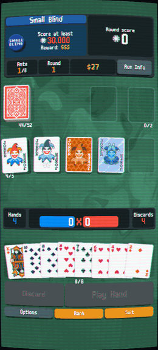
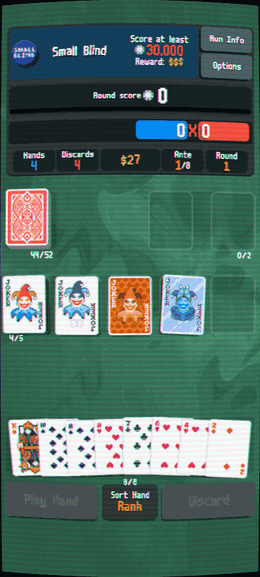
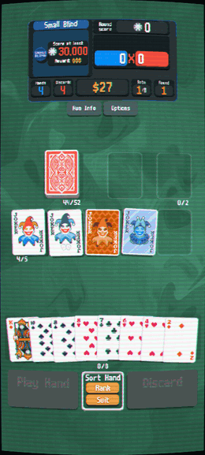
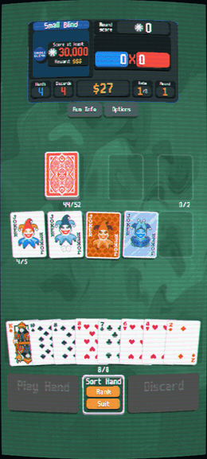
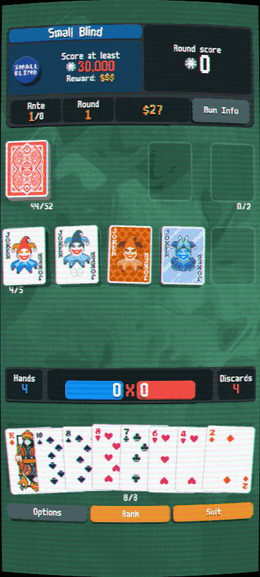

<div align="center">

# Balatro Portrait Mobile


**Balatro in portrait, played with one hand.**<br>
Android and iPhone · three layouts · Steamodded mods · every language the game ships

[](https://github.com/LoreanXavier/balatro-portrait-mobile/releases/latest)
[](https://github.com/LoreanXavier/balatro-portrait-mobile/actions/workflows/ci.yml)
[](https://www.patreon.com/loreanxavier)

<table>
  <tr>
    <td align="center"></td>
    <td align="center"></td>
    <td align="center"></td>
  </tr>
  <tr>
    <td align="center"><b>One-Thumb</b><br><sub>new · everything under your thumb</sub></td>
    <td align="center"><b>Focus</b><br><sub>new · one HUD, read top to bottom</sub></td>
    <td align="center"><b>Classic</b><br><sub>the 2.x layout, fixed up</sub></td>
  </tr>
</table>

**[Install](#install) · [What's new in 1.0.2](#whats-new-in-102) · [Mods](#mods) · [Save transfer](#save-transfer) · [Help](#troubleshooting) · [Support](#support-the-mod)**

</div>

---

## Install

You need a copy of Balatro you own; the game's art, sound and fonts always come
from it. Pick the row that matches you:

| | Your device | Install this | Root | Mods | The official app |
|:-:|---|---|:-:|:-:|---|
| 🤖 | Android + a PC | [**Portrait APK**, built on the PC](#-portrait-apk-built-on-a-pc) | no | ✅ | stays; the portrait app installs next to it |
| 📱 | Android, no PC | [**Portrait APK**, built on the phone](#-portrait-apk-built-on-the-phone) | no | ✅ | stays; its files are what gets built from |
| 🔓 | Rooted Android, keep the official app | [**Zygisk module**](#-zygisk-module-root) | yes | ✅ (experimental) | is what you play, in portrait |
| 🍎 | iPhone / iPad | [**IPA**](#-iphone-experimental) (experimental) | no | ✅ | not involved |

> [!TIP]
> **Not sure? Take the APK.** It needs no root, its mod support is the most
> tested, and it works on rooted phones too. The APK and the Zygisk module can
> be installed side by side.

<details>
<summary><b>APK or Zygisk: what is the difference?</b></summary>
<br>

| | Portrait APK | Zygisk module |
|---|---|---|
| Root | not needed | Magisk, KernelSU or APatch with Zygisk |
| What it is | a separate app (`com.unofficial.balatro`) you build from your own copy | a module that switches the official Play app to portrait as it starts |
| Mods | yes (Lovely + Steamodded) | yes, experimental (Lovely is built into the module) |
| Save | its own; [import yours](#save-transfer) | the official app's own |
| Readabletro, CRT off | chosen when you build | chosen when you flash |
| After a Play Store update | unaffected | may need a new module release |
| Phones | any the game runs on | arm64 only |

</details>

### What is on the Releases page

| File | What it is | For |
|---|---|---|
| `balatro_portrait.zip` | the Zygisk module, flashable from Magisk, KernelSU or APatch | rooted Android |
| `Source code (zip)` | the build scripts and the portrait code, at this release | building the APK or the IPA |
| `SHA256SUMS.txt` | checksums | checking a download |

There is no ready-made APK or IPA, and there will not be one: it would contain
the whole game. Yours takes a few minutes to build.

---

### 🤖 Portrait APK, built on a PC

Windows, macOS or Linux, with **Python 3.6+** and the desktop (Steam) Balatro,
or the `base.apk` of your Play Store copy.

1. **Get the code.** Download **Source code (zip)** from the
   [latest release](https://github.com/LoreanXavier/balatro-portrait-mobile/releases/latest)
   and unzip it, or:

   ```sh
   git clone https://github.com/LoreanXavier/balatro-portrait-mobile.git
   cd balatro-portrait-mobile
   ```

2. **Build.**

   ```sh
   python build.py
   ```

   The first run asks where `Balatro.exe` is. The JDK and Android build tools
   download on their own (about 250 MB, once).

3. **Install** the APK on the phone, by USB:

   ```sh
   adb install balatro-mobile-maker/balatro-aligned-debugSigned.apk
   ```

   or copy that file to the phone and open it there.

<details>
<summary><b>Build options</b></summary>
<br>

```sh
python build.py --steamodded                        # bundle Steamodded (the tested release)
python build.py --import-save "%APPDATA%\Balatro"    # bring your desktop save across
python build.py --disable-crt                       # if you see a black ellipse at the bottom
python build.py --no-readabletro                    # the game's original font and textures
python build.py --ios                               # also build the iPhone IPA
python build.py --balatro "D:\Steam\steamapps\common\Balatro\Balatro.exe" --force
```

</details>

### 📱 Portrait APK, built on the phone

No PC: the official Play Store Balatro on your phone is where the game files
come from.

1. Install **Balatro from Google Play** and open it once.
2. Install **Termux** from [F-Droid](https://f-droid.org/packages/com.termux/)
   or [GitHub](https://github.com/termux/termux-app/releases). Not the Google
   Play one: it is abandoned and cannot install what the build needs.
3. In Termux, run `termux-setup-storage` and tap **Allow**.
4. Paste this and press Enter:

   ```sh
   pkg update -y && pkg install -y git && rm -rf balatro-portrait-mobile && git clone https://github.com/LoreanXavier/balatro-portrait-mobile.git && cd balatro-portrait-mobile && bash termux-build.sh --force
   ```

5. Answer its questions (Readabletro, CRT shader, a save to import,
   Steamodded). The APK lands in `Download/balatro-portrait-mobile.apk`.
6. Open it from your file manager to install.

Every `build.py` option works here too (`bash termux-build.sh --steamodded latest`).
Full guide: [docs/TERMUX.md](docs/TERMUX.md).

> [!NOTE]
> **Updating:** build the new release the same way and install it over the old
> app. Your save lives in the app's data, so it stays.

### 🔓 Zygisk module (root)

You need **Magisk** with Zygisk turned on, or **KernelSU / APatch** with
**ReZygisk** or **Zygisk Next**, on an arm64 phone.

1. Install **Balatro from Google Play** and open it once.
2. Download **`balatro_portrait.zip`** from the
   [latest release](https://github.com/LoreanXavier/balatro-portrait-mobile/releases/latest).
3. Root manager → **Modules** → **Install from storage** → the zip.
4. Answer with the volume keys (**Vol+ yes, Vol− no**):
   *Apply Readabletro font/textures?* (default yes) and
   *Disable CRT in portrait mode?* (default no).
5. **Reboot**, then open the official Balatro.

Flash the zip again to change an answer. Remove the module in the root manager
and reboot to go back to landscape; your save is never touched. Root managers
find new versions on their own. For mods, see [Mods on the Zygisk module](#mods-on-the-zygisk-module). How it works, and building it yourself:
[zygisk/README.md](zygisk/README.md).

### 🍎 iPhone (experimental)

On a PC with the desktop game: `python build.py --ios`, then sideload
`balatro-portrait.ipa` with [Sideloadly](https://sideloadly.io/) or
[AltStore](https://altstore.io/). Mods load as on Android (`--ios-vanilla`
builds without the mod loader). Guide: [docs/IOS.md](docs/IOS.md).

The notch, Dynamic Island and home-indicator insets are tested on emulated
iPhone SE, 15 and 15 Pro Max screens, not yet on a real iPhone. If something
looks off, send the **Options → Diagnostics** report and a screenshot in an
[issue](https://github.com/LoreanXavier/balatro-portrait-mobile/issues).

---

## What's new in 1.0.2

- **The black ellipse, second try.** 1.0.1 did not cure it on a Pixel 7. The CRT
  shader's noise, which draws that curve, is now left out on every install route,
  as in the official Android game. The CRT effect stays on.

## What's new in 1.0.1

- **The APK's mod folder is `ASET/Mods/` again**, so
  [Balatro Mod Manager for Android](https://github.com/danitsdev/balatro-mod-manager-android)
  works with it. Your mods move there by themselves: open the game once, then
  restart it.
- **Options → Settings → Graphics → Frame Rate**: 30 or 60 instead of your
  screen's rate, to save battery.
- One-Thumb's score line keeps its height when the hand's total comes up, so it
  no longer touches the played cards on a tablet.

Everything else is in the [changelog](CHANGELOG.md).

## What's new in 1.0.0

> [!IMPORTANT]
> **1.0.0 is a reboot.** The project has a new home (this repository) and a new
> version line. The old repository and its account are gone, and the 2.x
> releases and issues with them. Coming from 2.x? See
> [the notes below](#coming-from-2x).

<table>
  <tr>
<td width="50%" valign="top">

**🎛️ Three layouts, switch any time**<br>
Options → Settings → Game → Layout, applied at once, even mid-hand.

</td>
<td width="50%" valign="top">

**👆 Swipe to play**<br>
Flick a selected card up to play the hand, down to discard it. Turn on
**Swipe Only Mode** and Play and Discard go away in every layout: the cards
grow into their room, and a small cue shows the two directions while cards are
selected.

</td>
  </tr>
  <tr>
    <td align="center"></td>
    <td align="center"></td>
  </tr>
</table>

- **One-Thumb** puts a short HUD on top and the hand's chips × mult right above
  your cards, with Play and Discard as the biggest buttons where your thumb
  already is. **Focus** reads top to bottom in one HUD, with a bar filling
  towards the blind's target. **Classic** is the 2.x layout and the default.
- **Nothing runs off the screen.** Every menu is measured as it opens and
  fitted inside the screen: the Collection, Editions, Booster Packs, Run Info,
  Run Setup and the menus mods add. Shop, packs and blind select stay on
  screen on tablets.
- **Readable in all 14 languages the game ships.** Long German, French, Dutch,
  Russian and Italian labels wrap instead of shrinking to 3 px; Japanese and
  Chinese hand names keep their size.
- **Huge numbers fit.** 99,999,999,999 and naneinf scores, $9,999,999,999,
  ante 39, jokers and consumables past their slot limit, 12-card hands.
- **Mods work better.** Steamodded's hand limit shows in every layout,
  Cryptid starts and its intro takes taps, old Steamodded's counters no longer
  read "52/nil". [Tested list below](#mods).
- **Tested on the real game before every release:** 8 screen sizes, Android
  and iOS code paths, 14 languages, 5 mod sets and the Zygisk module, with a
  bot playing whole runs.

**Support on Patreon** sits at the bottom of Options, on the title screen and
during a run.

Still here: anti-jitter touch, refresh rate matched to your screen,
**Options → Diagnostics** for bug reports, save transfer.
Everything, in detail: [CHANGELOG.md](CHANGELOG.md).

---

## Mods

The APK and the iPhone app carry [Lovely](https://github.com/ethangreen-dev/lovely-injector),
so Lovely and Steamodded mods run. The Zygisk module has Lovely built in too
([see below](#mods-on-the-zygisk-module)).

```sh
python build.py --steamodded           # bundle the Steamodded release this build is tested with
python build.py --steamodded latest    # the newest release (may not be tested yet)
```

A bundled mod installs itself on the first launch; restart once and it is on.

**Tested for 1.0.2** in all three layouts, on a 360 dp phone, a 412 dp phone,
an iPhone SE and a tablet: start, every menu, a full run, the stress test and
the Mods menu.

| Mods | |
|---|:-:|
| Steamodded 26.1002.0 | ✅ |
| Steamodded 1.0.0-beta-1814a | ✅ |
| + Talisman 2.7 (scores to e1000) | ✅ |
| + JokerDisplay 2.0.8 | ✅ |
| + Amulet 3.6.1 + Cryptid 0.5.17d | ✅ |

<details>
<summary><b>Adding mods by hand</b></summary>
<br>

1. Open the game once, then close it.
2. Install [Material Files](https://play.google.com/store/apps/details?id=me.zhanghai.android.files).
3. Menu → **Add storage** → **External storage** → the **Balatro** app →
   **Use this folder**.
4. Put the mod's folder in `ASET/Mods/`, then restart the game.

[Balatro Mod Manager for Android](https://github.com/danitsdev/balatro-mod-manager-android)
does this for you: pick the Balatro app's folder when it asks. ADB and root file
managers work too: [docs/MODDING.md](docs/MODDING.md).

</details>

### Mods on the Zygisk module

> [!WARNING]
> **Experimental.** The mods themselves are tested on the same portrait code the
> module carries, but the module's Lovely hook has not run on a real phone yet.
> If it misbehaves, empty the folder below and the module goes back to plain
> portrait. Reports with `adb logcat -s BalatroPortrait` are very welcome.

1. Open the official Balatro once, so it makes its save folder.
2. Put each mod's folder in **`/sdcard/BalatroMods/`** (the module made it), for
   example `/sdcard/BalatroMods/Steamodded/`.
3. Press the module's **Action** button in your root manager, or reboot.
4. Open the game.

The module copies the mods into the app's private folder with the right owner.
A mod taken out of `BalatroMods` is removed from the game at the next sync.
With no mods in the folder, Lovely never starts.

## Save transfer

Bring your unlocks from desktop Balatro or the official Play app (through Google
Takeout, no root) into the portrait APK. The build can put the save in for you:

```sh
python build.py --import-save "%APPDATA%\Balatro"        # desktop save folder
python build.py --import-save takeout-XXXXXXXX-001.zip   # official-app export
```

The Zygisk module needs none of this: it plays on the official app's own save.
Walkthrough and the manual route: [docs/SAVE_TRANSFER.md](docs/SAVE_TRANSFER.md).

## Coming from 2.x

- **APK:** build 1.0.0 and install it over the 2.x app; same package, so the
  save stays. If Android says the package conflicts, the old one was signed on
  another machine: back up your save
  ([docs/SAVE_TRANSFER.md](docs/SAVE_TRANSFER.md)), uninstall, install.
- **Zygisk:** flash the 1.0.0 zip over the old module and reboot. The old
  module looks for updates at the deleted repository, so it will not find
  1.0.0 by itself.
- **Layout:** you stay on Classic until you pick another one.
- **Build flags:** `--crt` / `--no-crt` are gone (they did the opposite of
  their names); use `--disable-crt` or `--keep-crt`.

## FAQ

<details>
<summary><b>Can I just download a ready-made APK?</b></summary>
<br>
No. An APK would contain the game, and the game is not ours to hand out. The
build makes one from your own copy, on a PC or on the phone.
</details>

<details>
<summary><b>Does it work with the Google Play version?</b></summary>
<br>
Yes. <a href="#-portrait-apk-built-on-the-phone">Built on the phone</a>, the APK
is made from the Play Store copy, no PC or root needed. With root, the
<a href="#-zygisk-module-root">Zygisk module</a> runs inside the official app.
</details>

<details>
<summary><b>Do cloud saves work?</b></summary>
<br>
<b>APK:</b> no. It is a separate app with no Google Play Games in it, so its save
stays on the phone. <a href="#save-transfer">Save transfer</a> brings your
progress across once. <b>Zygisk:</b> it is the official app and the module leaves
its saving alone, but this has not been tested.
</details>

<details>
<summary><b>Do achievements count?</b></summary>
<br>
Unlocks inside the game all work. On the APK, Steam and Google Play achievements
do not, since it is connected to neither.
</details>

<details>
<summary><b>Do I sign in to anything? Where do my credentials go?</b></summary>
<br>
The APK has no sign-in at all. The Zygisk module does not touch the official
app's own Google sign-in. The mod sends nothing over the network; its one link,
the Patreon button, opens your browser. The build only downloads its tools, your
game files stay on your machine, and all of it can be read in this repository.
</details>

<details>
<summary><b>It uses a lot of battery</b></summary>
<br>
Every frame runs the background and CRT shaders over the whole screen. Set
<b>Options → Settings → Graphics → Frame Rate</b> to 30, which halves that work on
a 60 Hz screen and more on a 90 or 120 Hz one.
</details>

## Troubleshooting

<details>
<summary><b>The game will not start</b></summary>
<br>
Make sure the first-run extraction finished: <code>src/game.lua</code>,
<code>src/resources/</code> and <code>src/localization/</code> must exist. Run
<code>python build.py</code> again.
</details>

<details>
<summary><b>The build fails</b></summary>
<br>
Check <code>python --version</code> (3.6+). The first build downloads the JDK and
build tools (about 250 MB), so it needs an internet connection. That can take a
few minutes: it is working as long as the progress bar moves.
</details>

<details>
<summary><b>A black ellipse or a coloured sliver at the bottom</b></summary>
<br>
Update to 1.0.2 first. If you still see one, please open an issue with your
phone's model. Until then, rebuild with <code>--disable-crt</code>; with
Zygisk, flash again and answer yes to <i>Disable CRT</i>.
</details>

<details>
<summary><b>The Zygisk module does nothing</b></summary>
<br>
Check that Zygisk is on in your root manager, that the module is enabled, and
that you rebooted after flashing. <code>adb logcat -s BalatroPortrait</code> shows
whether its hooks went in. A Play Store update of Balatro can change the game
so the patches no longer fit: the game then starts as shipped, and
<code>portrait_patch_error.txt</code> in its save folder says what happened. Look
for a new module release.
</details>

<details>
<summary><b>Something is misplaced or cut off</b></summary>
<br>
Open <b>Options → Diagnostics</b>, tap <b>Copy to clipboard</b> and paste the
report into an <a href="https://github.com/LoreanXavier/balatro-portrait-mobile/issues">issue</a>
with a screenshot. It has your screen's exact size and safe-area numbers.
</details>

Guides: [Termux](docs/TERMUX.md) · [Zygisk](zygisk/README.md) · [iPhone](docs/IOS.md) ·
[Mods](docs/MODDING.md) · [Save transfer](docs/SAVE_TRANSFER.md)

<details>
<summary><b>For contributors: the headless test suite</b></summary>
<br>

`tools/headless/run.py` runs the real game on a Windows PC, on a desktop of its
own that never shows on screen, as a phone of any size, and plays it from a
script. The GIFs above were recorded with it.

```sh
python tools/headless/run.py --scenario all --device all
python tools/headless/run.py --scenario layouts,stress,menus --device narrow --lang de
python tools/headless/run.py --scenario all,mods --mods smods-26,talisman
python tools/headless/run.py --source zygisk --scenario all   # as the Zygisk module runs it
python tools/headless/suite.py          # the whole matrix in one pool, before a release
```

See [tools/headless/README.md](tools/headless/README.md).

</details>

---

## Support the mod

<div align="center">

Free, and made in spare time. If it made mobile Balatro better for you,
you can help keep it going.

<a href="https://www.patreon.com/loreanxavier"></a>

</div>

## Credits

**LocalThunk** for Balatro · **LÖVE** for the engine ·
**KtourzaJeremy** for pull requests ·
**[ethangreen-dev](https://github.com/ethangreen-dev)** for Lovely ·
**[WilsontheWolf](https://github.com/WilsontheWolf)** for Lovely Mobile Maker ·
**[bladeSk](https://github.com/bladeSk)** for Readabletro ·
**[blake502](https://github.com/blake502)** for the Balatro APK Maker

## License and disclaimer

An unofficial fan mod, not made or endorsed by LocalThunk or Playstack. You need
your own legal copy of Balatro: the game's art, sounds, fonts and translations
come from your copy at build time and are not included here. The game's code is
not in this repository or in the Zygisk module either: `patches/` holds what the
mod changes, and where the Play build differs from Steam's, and it is applied to
your copy, at build time or on the phone.

The build tooling, documentation and portrait-mode changes are under the
[MIT License](LICENSE). All rights to Balatro, including the game code and
assets this project builds on, belong to LocalThunk / Playstack. See the scope
note in [LICENSE](LICENSE).
